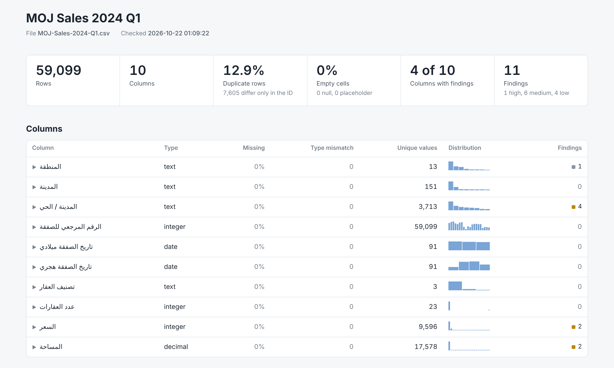

# Data quality audit skill

SDAIA Academy capstone. A Claude skill that audits one table and writes a one-page HTML dashboard. It finds data quality problems. It does not fix them.

| Path | Content |
| --- | --- |
| `skill/data-quality-audit/` | Skill source |
| `skill/data-quality-audit.skill` | Skill package |
| `docs/capstone-board.pdf` | Capstone board (Arabic) |
| `docs/capstone-deck.pdf` | Presentation (Arabic) |
| `data/` | MOJ real estate sales, Q1 2024, and the audit config |
| `output/dq_dashboard.html` | Dashboard for the MOJ data |

